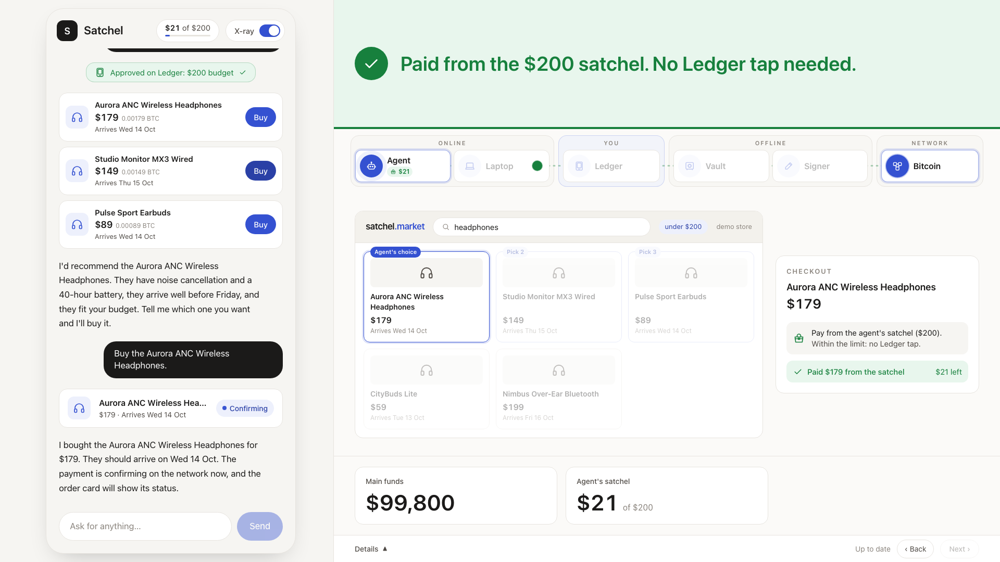
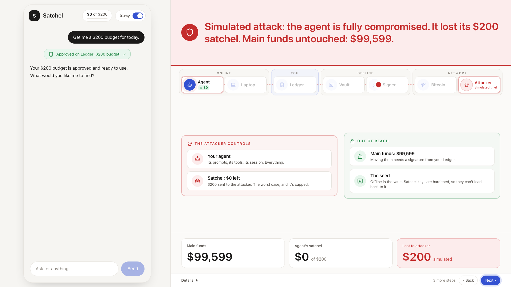
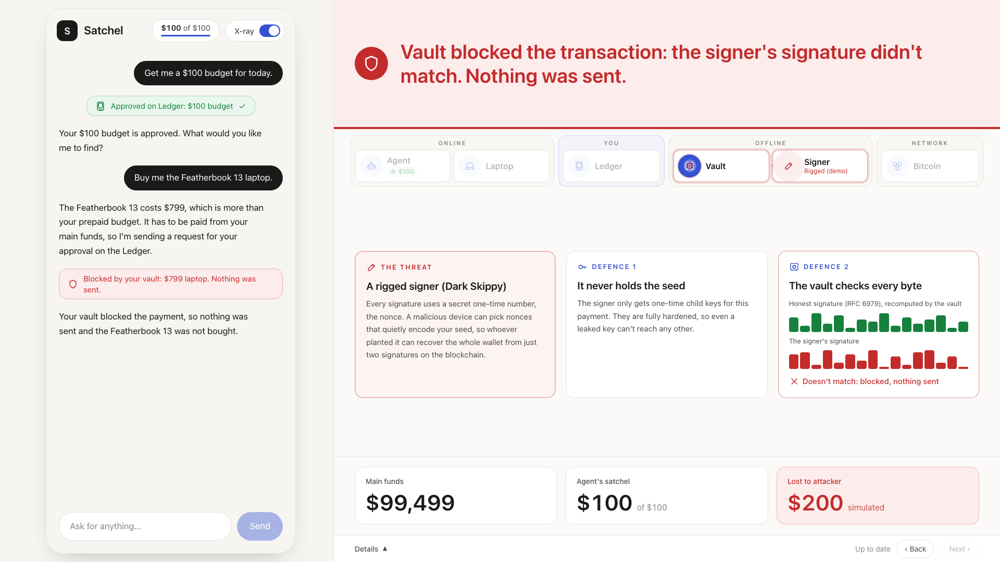
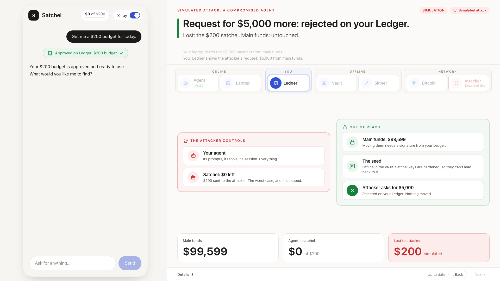

# satchel
prepaid sats for your agents, seedless by design

## Prerequisites

- [uv](https://docs.astral.sh/uv/) (manages Python 3.12 and the workspace)
- Docker Desktop (for the local regtest bitcoind)

## Layout

| folder | what it is |
| --- | --- |
| `core/` | `satchel-core`: shared library, including the regtest bitcoind client |
| `vault/` | `satchel-vault`: simulated air-gapped seed holder; never sends a signature, never touches the network |
| `laptop/` | `satchel-laptop`: online coordinator; reads vault payloads over HTTP and overlays chain data |
| `signer/` | `satchel-signer`: offline signer, one child key per payment |
| `agent/` | `satchel-agent`: shopping agent and its prepaid envelope wallet |
| `marketplace/` | `satchel-marketplace`: demo marketplace |
| `approver/` | Node/TypeScript Ledger approval service (DMK + Speculos) |
| `xray/` | `satchel-xray`: merged live event stream (SSE) and state snapshot for the x-ray view |
| `web/` | Next.js chat product with the x-ray panel |
| `scripts/` | `regtest.py`, funding helpers, `demo_reset.py` and `demo_scenarios.py` |
| `tests/` | workspace-level tests |

## Running the demo

Needs Docker, uv, Node 26 + pnpm, and an Anthropic key in `.env` (`ANTHROPIC_API_KEY=...`, gitignored).

```sh
uv run scripts/demo_reset.py           # one command: fresh chain, fixed demo vault, funded main funds,
                                       # all services started (ports 8000-8006); satchels are created on request
cd web && pnpm install && pnpm dev     # chat product on http://localhost:3100
uv run scripts/demo_scenarios.py       # plays the three scenarios with scripted Ledger decisions, PASS/FAIL
uv run scripts/demo_reset.py --stop    # stop the demo services (Docker containers stay up)
```

The web app opens in **shopper mode**: a plain chat with a budget pill. The **X-ray** switch shrinks
the chat to a phone-width third and gives the x-ray the other two thirds. The x-ray tells the story
one step at a time: a caption bar says what happened and why it matters, the device strip (Online /
You / Offline / Network) lights up only the devices involved, and a stage panel under it shows the
chapter: creating a satchel (main funds → new satchel → agent, the hardened path and an 11-step
checklist), the agent shopping in the store (search, picks, checkout inside the satchel), the
compromised agent (what the attacker controls and what stays out of reach), and the rigged signer
(Dark Skippy, and the vault's byte-for-byte signature check). Three big numbers show main funds, the
agent's satchel and, from the compromise scene on, what the attacker took; they follow the step on
screen. When an approval is pending the stage gives way to the emulated Ledger showing the exact plan;
approve or reject with the device buttons (or tap, swipe and hold the screen). "Details" at the bottom
holds the event log and the QR payloads; click a device to see its latest payload.

**Presenting:** the x-ray waits for the presenter: press **→** (or Space, PageDown, or "Next") for each
step and **←** (PageUp, "Back") to go back. Add `?autoplay=1` to the URL, or use the pace toggle in
the presenter drawer, to play steps on a timer instead. Press **P** for the presenter drawer (hidden
otherwise). Each scene button starts a fresh chat with that scene's scripted message, and each scene
creates its own satchel from main funds with one Ledger approval:

1. **Everyday purchase**: approve the $200 satchel, click Buy, then "Mine block" to confirm the order.
2. **Compromised agent**: approve a fresh $200 satchel, "Simulate compromised agent", then reject the
   attacker's $5,000 request on the Ledger. Only the satchel is lost.
3. **Malicious signer**: approve the $100 satchel, turn the random-nonce signer on, then buy the
   Featherbook 13; the vault blocks the forged signature.

"Reset demo" reruns `demo_reset.py` from the browser (about a minute) and reloads the page. Service
logs are in `.satchel/logs/`, scenario transcripts in `.satchel/logs/scenarios-*.txt`, and reset output
in `.satchel/reset.log`.

| Everyday purchase | Compromised agent | Malicious signer |
| --- | --- | --- |
|  |  |  |
| |  | |

## Security model

What each part holds, what it could do if it turned malicious, and what stops it:

| part | holds | if malicious, it could try to | what stops it |
| --- | --- | --- | --- |
| Agent | one satchel key | drain its satchel, ask for more | more needs a Ledger signature; satchel keys are fully hardened, so one reveals no other key |
| Signer | one-time keys for the coins being spent, never the seed | sign a different transaction, or hide keys in its nonces (Dark Skippy) | before any broadcast the vault compares the transaction field by field with the approved PSBT and recomputes every RFC 6979 signature byte for byte |
| Ledger | an Ethereum key for approvals, no Bitcoin keys | approve something you didn't intend | it can only answer requests; it can't start a payment or spend anything |
| Laptop | addresses, public keys, chain data | propose a bad PSBT | the vault checks every input is its own key, the payment is exactly what the Ledger signed, every other output is a vault change key, and the fee is at most 100,000 sats |
| Vault | the seed | anything | nothing: it is the one device you must trust. It stays offline, sends no signatures, and mixes at least 50 dice rolls (128 bits) into the seed so a broken RNG can't make it guessable |

Known limits:

- **Demo shortcut:** the laptop carries the vault's key release to the signer over HTTP, so in this
  demo the online laptop sees the one-time keys for the coins being spent, and a compromised laptop
  could take those coins (whole UTXOs, not just the payment). On real hardware this hop is a QR
  code from the offline vault straight to the offline signer, so the laptop never sees a main-funds
  key. The satchel key does pass the laptop on its way to the agent, which caps that loss at the
  satchel, the same as a compromised agent.
- **What the Ledger shows:** the amount, the full destination address, what it's for and, for a
  satchel, how long the approval stands. The signature covers exactly that text, so a look-alike
  address can't reuse it. The fee is not shown: the vault caps it at 100,000 sats, and checks that
  every input is a vault key and every other output a vault change key.
- **Approval deadline:** a satchel approval is "valid until" a time: the deadline for the vault to
  fund it and hand over its key. Once the agent holds the key, nothing expires and nothing can
  freeze it: a satchel is cash, not a card.
- **Confirmation proof:** before releasing a satchel key the vault checks a merkle proof of the
  funding against a block header and that header's own proof of work. Being offline, it can't
  see the chain, so this proves inclusion in a mined header, not how much work is behind it.
- **No xpub, but public keys on the laptop:** nothing ever exports an xpub, so no single string
  reveals every public key. The laptop does keep the public key of each address the vault exported
  (it needs them to build PSBTs), so an attacker with the laptop and a future quantum computer
  could target unspent coins at those addresses.

## Quickstart

```sh
uv sync                                # create the venv and install the workspace

uv run scripts/regtest.py up           # start bitcoind, create/load the faucet wallet
uv run scripts/regtest.py fund <bcrt1 address> [sats]   # send sats (default 1000000) + mine a block
uv run scripts/regtest.py unspent <address> [...]       # list confirmed UTXOs

uv run pytest                          # unit tests; integration tests skip if the node is down

uv run scripts/regtest.py down         # stop bitcoind (chain state is kept)
docker compose down -v                 # stop and wipe the chain volume
```

The node listens on `http://127.0.0.1:18443` with RPC credentials
`satchel`/`satchel`. This is a local regtest node only; those credentials are
not used anywhere else. `RegtestNode` can also be configured via
`BITCOIND_RPC_URL`, `BITCOIND_RPC_USER`, and `BITCOIND_RPC_PASSWORD`.

## Ledger approver (Speculos)

```sh
cd approver && pnpm install && pnpm fetch-app && cd ..  # official Ethereum app ELF (Flex), sha256-pinned
docker compose --profile ledger up -d speculos          # emulated Ledger Flex; web UI at http://127.0.0.1:5001
(cd approver && pnpm start)                             # approver on 127.0.0.1:8003
curl -s 127.0.0.1:8003/address                          # the Ledger address to register in the vault
docker compose --profile ledger stop speculos
```

Plans go to `POST /approve`; the plain-English text appears on the Speculos screen and must be
approved there (manual by default). For rehearsals only, start the approver with
`SATCHEL_APPROVER_DEMO_AUTOMATION=1` to script approvals. See `approver/README.md`.

## Demo marketplace

```sh
uv run satchel-marketplace serve                        # 127.0.0.1:8004 (regtest only)
curl -s '127.0.0.1:8004/products/search?q=headphones&max_price_usd=200&deliver_by=2026-10-16'
curl -s -X POST 127.0.0.1:8004/checkout -H 'content-type: application/json' -d '{"product_id": "aurora-anc-wireless-headphones"}'
curl -s 127.0.0.1:8004/orders/<order_id>                # awaiting_payment / payment_pending / underpaid / paid
```

20 products in `marketplace/src/satchel_marketplace/catalogue.json` (headphones, laptops, kitchen,
accessories), priced in BTC at a fixed demo rate of $100,000/BTC. Each order gets a fresh address
from the node's `merchant` wallet and is marked paid once the payment has one confirmation.
Orders live in `.satchel/marketplace/orders.json` (`SATCHEL_MARKETPLACE_DIR`).

## Shopping agent

```sh
export ANTHROPIC_API_KEY=...                            # the agent uses claude-sonnet-5-5 (SATCHEL_AGENT_MODEL)
uv run satchel-laptop serve                             # coordinator flows: POST /grants, POST /spends
uv run satchel-agent serve                              # 127.0.0.1:8005
curl -N -X POST 127.0.0.1:8005/chat -H 'content-type: application/json' \
  -d '{"message": "Find me headphones under $200 that arrive by Friday."}'
uv run scripts/regtest.py miner --interval 10           # demo: mine a block every 10 s so payments confirm
```

`POST /chat` streams Server-Sent Events (`session`, `text`, `tool_call`, `notice`, `tool_result`, `error`, `done`).
A `notice` event ("This purchase exceeds your prepaid budget and needs your approval on the Ledger") is
always sent when `request_large_purchase` starts, before the Ledger approval is requested;
pass the returned `session_id` to continue a conversation, and `GET /sessions/{id}` shows its
history and budget. The agent's only key is the envelope it was granted; anything larger goes
through the laptop's large-spend flow and the Ledger. Service URLs: `SATCHEL_MARKETPLACE_URL`
(default `http://127.0.0.1:8004`), `SATCHEL_LAPTOP_URL` (default `http://127.0.0.1:8000`).
`SATCHEL_AGENT_DEMO_AUTO=approve` (with the approver's demo automation on) scripts Ledger
decisions for rehearsals only.

Demo only: start the agent with `SATCHEL_AGENT_DEMO_CONTROLS=1` to enable the simulated-compromise
control. `POST /demo/compromise {"session_id": ...}` runs a deterministic script (no LLM) as if an
attacker controlled the agent: it sends the whole envelope to a separate `loss-sink` wallet on the
node, then asks the laptop's large-spend flow for 0.05 BTC more to the same address, which lands on
the Ledger. `GET /demo/loss-sink` reports the sink's balance for the x-ray view.

## Vault and satchels

```sh
export SATCHEL_VAULT_PASSPHRASE='choose-a-passphrase'   # or omit to be prompted
uv run satchel-vault setup --dice "<at least 50 dice rolls, digits 1-6>" --ledger-address 0x...
uv run satchel-vault serve                              # payload API on 127.0.0.1:8001
uv run scripts/fund_main_funds.py                       # faucet-funds a few main-funds addresses
uv run satchel-laptop serve                             # coordinator on 127.0.0.1:8000
curl -s 127.0.0.1:8000/envelopes                        # status + on-chain balance per satchel
uv run satchel-signer serve                             # signer on 127.0.0.1:8002 (POST /sign)
uv run satchel-vault reset --yes                        # demo only: wipe seed and inventory
```

The laptop package also runs the two coordinator flows, carrying payloads between vault, approver
and signer (it never derives or stores vault keys):

- `satchel_laptop.satchel.create_satchel(agent_id, budget_sats, ...)` creates a satchel with one
  Ledger approval: the vault reserves a fresh hardened satchel key, the laptop drafts a main-funds
  PSBT paying exactly the budget to it, and after approval it runs the same path as a large spend
  (vault releases only the main-fund keys, signer signs, vault verifies, broadcast). Once the
  funding confirms, the vault checks a `gettxoutproof` of exactly the transaction it verified and
  only then releases the satchel key, which goes to the agent's satchel wallet.
- `satchel_laptop.spend.large_spend(destination, amount_sats, purpose, ...)` selects UTXOs, builds
  the PSBT (change to a fresh hardened vault change address), gets it approved on the Ledger, has
  the vault release only the input keys, the signer sign and the vault verify, and broadcasts only
  through `broadcast_verified(node, signed_tx, verification_pass)`.

Every hop emits an event and is recorded with its QR-ready payload (key releases redacted) in
`.satchel/laptop/flows/<flow_id>.json`. Service URLs: `SATCHEL_VAULT_URL`, `SATCHEL_APPROVER_URL`
(default `http://127.0.0.1:8003`), `SATCHEL_SIGNER_URL` (default `http://127.0.0.1:8002`).

Keys only leave the vault with a Ledger approval: `POST /release/satchel-funding` (satchel grant
plus its funding PSBT), `POST /release/satchel` (the satchel key, after a confirmation proof of the
verified funding) and `POST /release/spend` (large spend plus its unsigned PSBT). Each approval must
recover to the registered Ledger address, match the text the vault rebuilds from the plan, be
unexpired and use a fresh nonce; PSBTs must match the approved hash and pay exactly the approved
amount to exactly the approved destination (the satchel's own address for a grant), with any change
going to a fresh hardened vault change key.

Before anything is broadcast, the vault's `POST /verify` checks the signer's transaction
against the approved PSBT and recomputes every signature byte for byte.

Demo only: start the signer with `SATCHEL_SIGNER_RANDOM_NONCE=1`, or toggle it live with
`curl -X POST 127.0.0.1:8002/demo/random-nonce -H 'content-type: application/json' -d '{"enabled": true}'`.
It then signs with plain random nonces: the network accepts the transaction, but vault verification fails it.

State lives in `.satchel/` (gitignored): `SATCHEL_VAULT_DIR` (default
`.satchel/vault`), `SATCHEL_LAPTOP_DIR` (default `.satchel/laptop`) and the
event log `SATCHEL_EVENT_LOG` (default `.satchel/events.jsonl`). The laptop finds
the vault via `SATCHEL_VAULT_URL` (default `http://127.0.0.1:8001`).
